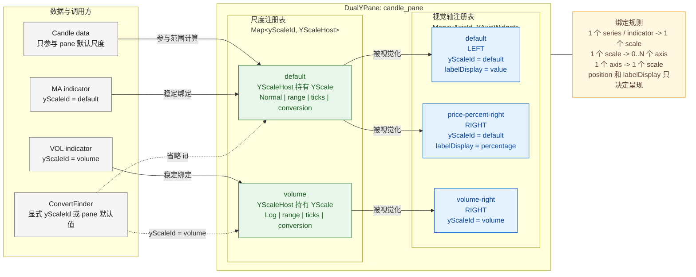
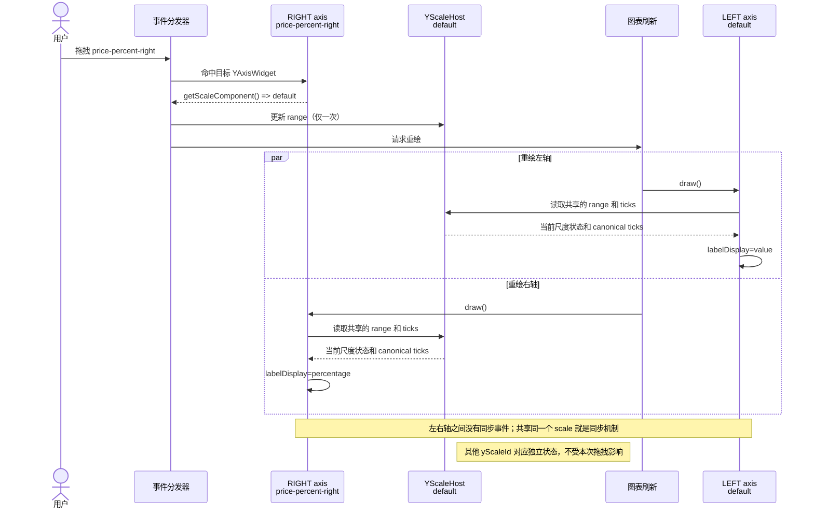
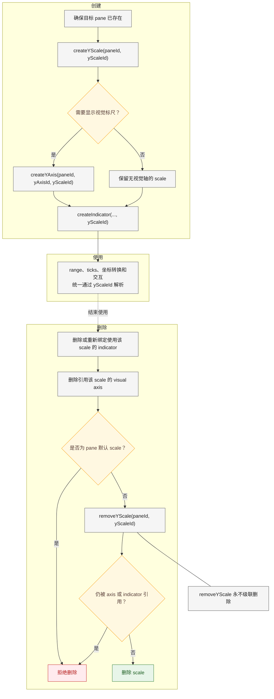

# Y Scale / Y Axis Breaking-Change Migration Guide

## 1. 迁移目标

这次变更将“数值坐标系”和“屏幕上可见的 Y 轴”拆成两个独立资源：

- `YScale` 是 pane 内的数值尺度，负责范围、变换类型、ticks、自动缩放、格式化以及数值/像素转换。
- `YAxis` 是视觉标尺，负责左/右位置、顺序、显示、交互命中和标签投影，并通过 `yScaleId` 引用一个已有尺度。
- 一个 `YScale` 可以不显示轴，也可以被任意数量的 `YAxis` 引用。
- 一个 indicator 在任一时刻只绑定一个 `YScale`。

## 2. 新架构

### 2.1 对象与绑定关系



`DualYPane` 持有两个彼此独立的 registry。`YScaleHost` 持有真正有状态的 `YScale`；`YAxisWidget` 持有位置、顺序、可见性、标签投影、绘制和命中测试能力。上图中从 scale 到 axis 的箭头表示“同一尺度被渲染到这些视觉位置”，axis 在对象模型中通过 `yScaleId` 反向引用该 scale。左轴直接显示价格，右轴把同一批 canonical tick value 投影为百分比文字，两边的 tick 坐标不变。

### 2.2 共享尺度交互



拖拽发生在 axis 上，但交互最终只修改它引用的 scale。所有引用同一个 scale 的视觉轴会在下一次绘制时读取同一份状态，因此不会产生双重更新、转换误差或左右轴状态漂移。

### 2.3 资源生命周期



scale 与 axis 的生命周期互相独立。删除 axis 不会删除 scale 或数据；删除 scale 前必须由调用方显式解除所有引用，且默认 scale 始终不可删除。

## 3. Breaking changes 总览

| 旧 API / 行为 | 新 API / 行为 | 迁移动作 |
| --- | --- | --- |
| `YAxisType` | `YScaleType` | 替换导入和枚举引用，不提供兼容别名 |
| `YScaleType.Percentage` / `YScaleType.MinutePercentage` | `YAxisLabelDisplay.Percentage` / `YAxisLabelDisplay.MinutePercentage` | scale 保持 `Normal` 或 `Log`，在每个 visual axis 上配置 `labelDisplay` |
| `registerYAxis(template)` | `registerYScale(template)` | 自定义变换注册到 Y-scale 扩展命名空间 |
| `YAxisOptions.type/name/nice/axisTitle/scrollZoomEnabled` | `YScaleOptions` 中的同名字段 | 先创建或覆盖 scale，再让 axis 引用它 |
| `styles.yAxis.reverse` | `YScaleOptions.reverse` | 按尺度设置反转状态 |
| `Indicator.yAxisId` | `Indicator.yScaleId` | 将数据绑定改为尺度绑定 |
| `Indicator.yAxisPosition` | 删除 | 位置属于视觉 axis，不再决定数据绑定 |
| indicator/overlay 回调参数 `yAxis` | `yScale` | 更新 attrs、draw、tooltip 和 overlay figure 回调中的参数名 |
| `ConvertFinder.yAxisId/yAxisPosition` | `ConvertFinder.yScaleId` | 坐标转换显式选择尺度 |
| `styles.yAxis.position/mainPosition` | 删除 | 使用 `createYAxis` / `overrideYAxis` 管理位置 |
| `YAxisPosition.Both` | 删除 | 创建两个引用同一 `yScaleId` 的视觉轴 |
| `PaneOptions.axisOptions.YAxis.left/right` | 删除 | 将 type、nice、formatter、axisTitle 移到具体 scale |
| `YAxisFilter.name` | `YScaleFilter.name` 或 `YAxisFilter.yScaleId` | 按扩展名筛 scale，按绑定关系筛 axis |
| indicator 引用未知 `yAxisId` 时隐式创建轴 | 未知 `yScaleId` 直接拒绝 | 显式按 scale -> axis -> indicator 顺序创建 |
| 删除 indicator 后自动清理孤立轴 | scale 与 axis 生命周期独立 | 调用方显式删除不再需要的 axis 和 scale |
| 内部 `component/YAxis`、`extension/y-axis` | `component/YScale`、`extension/y-scale` | 更新直接引用内部模块的集成代码 |

`styles.yAxis` 仍然负责轴线、tick、文字、`inside` 等视觉样式，但不再负责轴的拓扑或尺度语义。

本次 breaking change 也更新了公开扩展回调参数：indicator 的 figure attrs、draw、tooltip 回调以及 overlay 的 figure 回调都接收 `yScale`。使用 JavaScript 解构参数的扩展必须同步改名，否则读取旧的 `yAxis` 会得到 `undefined`。

## 4. 新模型的默认资源与不变量

每个可绘制 pane 创建时都会拥有：

```text
Y scale: id = "default"
Y axis:  id = "default", yScaleId = "default", position = "left"
```

两个 `default` 位于不同 registry，可以同名，但不是同一个对象。建议使用根包导出的 `DEFAULT_Y_SCALE_ID` 和 `DEFAULT_Y_AXIS_ID`，不要依赖字符串字面量。

必须遵守以下不变量：

1. `yScaleId` 只在所属 pane 内解析；跨 pane 的同名尺度是不同资源。
2. `createYAxis` 要求目标 scale 已存在，不会隐式创建 scale。
3. indicator 省略 `yScaleId` 时，会在创建时解析并存储 pane 的默认 scale；以后移动或增删 axis 不会改变绑定。
4. 拖动、滚轮缩放或重置 axis 时，只修改它引用的 scale。所有引用同一 scale 的 axis 自然同步，其他 scale 不受影响。
5. 默认 scale、仍被 axis 引用的 scale、仍被 indicator 绑定的 scale都不能删除。
6. 视觉 axis 可以独立删除；删除 axis 不会删除 scale 或 indicator。
7. `labelDisplay` 只投影标签文字，不参与 range、ticks、数值/像素转换或交互状态计算。

## 5. 迁移步骤

### 5.1 更新导入和自定义尺度注册

迁移前：

```ts
import { registerYAxis, YAxisType } from 'klinecharts'

registerYAxis(customAxisTemplate)
```

迁移后：

```ts
import { registerYScale, YScaleType } from 'klinecharts'

registerYScale(customScaleTemplate)
```

自定义模板的 `name` 现在由 `YScaleOptions.name` 选择，而不是由视觉轴选择：

```ts
const scaleId = chart.createYScale({
  id: 'custom-price',
  paneId: 'candle_pane',
  name: customScaleTemplate.name,
  type: YScaleType.Normal
})
```

### 5.2 将尺度配置从 axis/style 移到 YScale

迁移前：

```ts
chart.createYAxis({
  id: 'price-right',
  paneId: 'candle_pane',
  position: 'right',
  type: YAxisType.Log,
  nice: true,
  axisTitle: 'Price'
})
```

迁移后：

```ts
import { YScaleType } from 'klinecharts'

chart.createYScale({
  id: 'price-log',
  paneId: 'candle_pane',
  type: YScaleType.Log,
  nice: true,
  axisTitle: 'Price'
})

chart.createYAxis({
  id: 'price-right',
  paneId: 'candle_pane',
  yScaleId: 'price-log',
  position: 'right'
})
```

以下字段属于 scale：

- `name`
- `type`
- `scrollZoomEnabled`
- `reverse`
- `nice`
- `axisTitle`
- `formatter`

以下字段属于 visual axis：

- `yScaleId`
- `position`
- `order`
- `needWidget`
- `labelDisplay`
- `tickTextColor`（该视觉轴的刻度和标题文字颜色；设为 `undefined` 恢复跟随主题）
- `showTitle`（设为 `false` 仅隐藏该视觉轴的尺度标题；省略、`true` 或 `undefined` 保持显示。共用的刻度及标题避让不变，适合只在左侧显示成交量标题的镜像轴）

### 5.3 将单尺度显示在左右两侧

旧的 `styles.yAxis.position = 'both'` 和 `mainPosition` 不再存在。保留默认左轴，再创建一个引用相同 scale 的右轴：

```ts
import {
  DEFAULT_Y_AXIS_ID,
  DEFAULT_Y_SCALE_ID,
  PaneIdConstants,
  YAxisLabelDisplay
} from 'klinecharts'

chart.overrideYAxis({
  id: DEFAULT_Y_AXIS_ID,
  paneId: PaneIdConstants.CANDLE,
  position: 'left',
  labelDisplay: YAxisLabelDisplay.Value
})

chart.createYAxis({
  id: 'price-percent-right',
  paneId: PaneIdConstants.CANDLE,
  yScaleId: DEFAULT_Y_SCALE_ID,
  position: 'right',
  labelDisplay: YAxisLabelDisplay.Percentage
})
```

左右两个 axis 引用同一个 scale，因此范围、类型和 tick 坐标必然相同。左轴显示价格文字，右轴按可见区第一根 K 线的 `close` 显示百分比文字。拖动任意一个轴只会修改一次 scale 状态，另一个轴直接读取同一结果并重新投影自己的标签。

如果只是把默认轴移动到右侧，不需要创建新轴：

```ts
chart.overrideYAxis({
  id: DEFAULT_Y_AXIS_ID,
  paneId: PaneIdConstants.CANDLE,
  position: 'right'
})
```

### 5.4 将 indicator 从 yAxisId 迁移到 yScaleId

迁移前：

```ts
chart.createIndicator({
  name: 'VOL',
  yAxisId: 'volume',
  yAxisPosition: 'right'
}, true, { id: 'candle_pane' })
```

旧实现可能根据 `yAxisId` 隐式创建 axis。新实现要求资源生命周期显式化：

```ts
import { YScaleType } from 'klinecharts'

chart.createYScale({
  id: 'volume',
  paneId: 'candle_pane',
  type: YScaleType.Normal,
  axisTitle: 'Volume'
})

chart.createYAxis({
  id: 'volume-right',
  paneId: 'candle_pane',
  yScaleId: 'volume',
  position: 'right'
})

chart.createIndicator({
  name: 'VOL',
  yScaleId: 'volume'
}, true, { id: 'candle_pane' })
```

如果不需要显示视觉轴，可以省略 `createYAxis`。indicator 仍会使用该 scale 完成范围计算和绘制。

对于尚不存在的新 indicator pane，第一次 `createIndicator` 只能使用该 pane 自动创建的 `default` scale。需要额外尺度时，应先创建 pane，再调用 `createYScale`、`createYAxis` 和后续 `createIndicator`。

### 5.5 迁移 pane 级 YAxis 配置

迁移前：

```ts
chart.createIndicator('VOL', false, {
  id: 'volume-pane',
  axisOptions: {
    YAxis: {
      left: {
        type: YAxisType.Normal,
        nice: true,
        formatter: formatVolume,
        axisTitle: 'Volume'
      }
    }
  }
})
```

迁移后先创建 pane，再覆盖它的默认 scale：

```ts
import { DEFAULT_Y_SCALE_ID, YScaleType } from 'klinecharts'

const paneId = chart.createIndicator('VOL', false, { id: 'volume-pane' })

if (paneId) {
  chart.overrideYScale({
    id: DEFAULT_Y_SCALE_ID,
    paneId,
    type: YScaleType.Normal,
    nice: true,
    formatter: formatVolume,
    axisTitle: 'Volume'
  })
}
```

`PaneOptions.axisOptions.name` 和 `scrollZoomEnabled` 仍可初始化默认 scale；原来的 `axisOptions.YAxis.left/right` 分支已删除。

### 5.6 迁移 reverse 和轴位置样式

迁移前：

```ts
chart.setStyles({
  yAxis: {
    position: 'both',
    mainPosition: 'left',
    reverse: true
  }
})
```

迁移后：

```ts
import {
  DEFAULT_Y_AXIS_ID,
  DEFAULT_Y_SCALE_ID,
  PaneIdConstants
} from 'klinecharts'

chart.overrideYScale({
  id: DEFAULT_Y_SCALE_ID,
  paneId: PaneIdConstants.CANDLE,
  reverse: true
})

chart.overrideYAxis({
  id: DEFAULT_Y_AXIS_ID,
  paneId: PaneIdConstants.CANDLE,
  position: 'left'
})

chart.createYAxis({
  id: 'default-right',
  paneId: PaneIdConstants.CANDLE,
  yScaleId: DEFAULT_Y_SCALE_ID,
  position: 'right'
})
```

### 5.7 迁移坐标转换

迁移前：

```ts
chart.convertToPixel({ value: 100 }, {
  paneId: 'candle_pane',
  yAxisId: 'price-right',
  yAxisPosition: 'right'
})
```

迁移后：

```ts
chart.convertToPixel({ value: 100 }, {
  paneId: 'candle_pane',
  yScaleId: 'price'
})
```

省略 `yScaleId` 时使用 pane 的默认 scale，不再根据左/右位置寻找 axis。

## 6. 坐标变换与标签投影

`YScaleType` 只描述真实的坐标变换：

- `YScaleType.Normal`：数值差相同，像素距离相同。
- `YScaleType.Log`：数值比率相同，像素距离相同。

`YAxisLabelDisplay` 只描述 visual axis 如何显示 scale 提供的 canonical real value：

- `YAxisLabelDisplay.Value`：显示 canonical value。
- `YAxisLabelDisplay.Percentage`：仅对 candle pane 的默认价格 scale 生效，相对当前可见区第一根数据的 `close` 显示涨跌幅；其他 scale 或无有效基准时显示 `--`。
- `YAxisLabelDisplay.MinutePercentage`：相对 `ChartStore.getMinutePercentageBasis()` 的结果显示涨跌幅。

因此，同一个 normal price scale 可以在左边显示价格、右边显示百分比。这不是两个 scale，也没有同步过程：两条轴使用完全相同的 range、tick value、tick coordinate 和 interaction state，仅最终文字不同。`labelDisplay` 同样可以用于 log scale；实现会先把内部对数 tick 转回 canonical real value，再计算百分比。百分比投影仍只适用于 candle pane 的默认价格 scale。

Normal 与 Log 仍然不能作为同一个 scale 的两个视觉投影，因为它们改变的是坐标几何，而不是文字。要同时展示 normal 和 log 坐标，必须创建两个独立 scale；一个 indicator/series 仍只绑定一个 scale。candle 原始数据只参与 candle pane 默认 scale 的自动范围计算，仅创建第二个 Log scale 和 visual axis 不会自动把 candle series 绑定过去。

## 7. 生命周期与删除顺序

推荐创建顺序：

```text
existing pane -> createYScale -> createYAxis (optional) -> createIndicator
```

推荐删除顺序：

```text
remove/rebind indicators -> removeYAxis -> removeYScale
```

示例：

```ts
import { DEFAULT_Y_SCALE_ID } from 'klinecharts'

chart.overrideIndicator({
  id: 'external-price',
  yScaleId: DEFAULT_Y_SCALE_ID
}, 'candle_pane')

chart.removeYAxis({
  id: 'external-price-right',
  paneId: 'candle_pane'
})

const removed = chart.removeYScale({
  id: 'external-price',
  paneId: 'candle_pane'
})
```

当 scale 是默认 scale、仍被 axis 引用或仍被 indicator 绑定时，`removeYScale` 返回 `false`。这不是级联删除 API，调用方必须明确处理依赖关系。

`removeYAxis` 只删除视觉位置，不影响其 scale 或绑定的数据。通过 `removeYAxis({ yScaleId, paneId })` 可以删除 pane 内引用某个 scale 的所有视觉轴。

## 8. API 速查

```ts
chart.createYScale(options: YScaleCreate): string | undefined
chart.getYScales(filter?: YScaleFilter): YScaleOptions[]
chart.overrideYScale(options: YScaleOverride): void
chart.removeYScale(filter: YScaleFilter): boolean

chart.createYAxis(options: YAxisCreate): string | undefined
chart.getYAxes(filter?: YAxisFilter): YAxisOptions[]
chart.overrideYAxis(options: YAxisOverride): void
chart.removeYAxis(filter: YAxisFilter): boolean
```

关键参数约束：

- `YScaleCreate` 必须包含 `paneId`，`id` 可省略。
- `YAxisCreate` 必须包含 `paneId` 和已有的 `yScaleId`，`id` 可省略。
- `YAxisCreate.labelDisplay` 可省略，默认是 `YAxisLabelDisplay.Value`。
- `YScaleOverride`、`YAxisOverride` 必须包含 `id`；多 pane 存在同名 ID 时应同时传入 `paneId`。
- `removeYScale` 至少提供 `id` 或 `name`。
- `removeYAxis` 至少提供 `id` 或 `yScaleId`。

## 9. 迁移检查清单

- [ ] 将 `YAxisType` 替换为 `YScaleType`。
- [ ] 将 `YScaleType.Percentage/MinutePercentage` 迁移为 visual axis 的 `YAxisLabelDisplay`。
- [ ] 将 `registerYAxis` 替换为 `registerYScale`。
- [ ] 将 indicator 的 `yAxisId` / `yAxisPosition` 替换为 `yScaleId`。
- [ ] 将 indicator/overlay 回调参数中的 `yAxis` 改为 `yScale`。
- [ ] 将 `ConvertFinder.yAxisId/yAxisPosition` 替换为 `yScaleId`。
- [ ] 将 transform、nice、reverse、formatter、axisTitle 和交互开关移到 scale。
- [ ] 删除 `styles.yAxis.position/mainPosition` 和 `YAxisPosition.Both`。
- [ ] 将 `axisOptions.YAxis.left/right` 改为默认 scale 覆盖或显式 scale 创建。
- [ ] 在创建 visual axis 前显式创建目标 scale。
- [ ] 检查同一 scale 的多个 axis 是否确实应共享 type、range 和 ticks。
- [ ] 检查需要价格/百分比双轴的场景是否让两条 axis 引用同一 `yScaleId`，只配置不同 `labelDisplay`。
- [ ] 按 indicator -> axis -> scale 的依赖顺序更新清理逻辑。
- [ ] 为每个坐标转换调用确认正确的 `yScaleId`。
- [ ] 更新直接引用 `component/YAxis` 或 `extension/y-axis` 的内部集成。

建议在代码库中扫描以下旧标识：

```sh
rg -n "YAxisType|registerYAxis|yAxisId|yAxisPosition|mainPosition|YAxisPosition\\.Both|axisOptions.*YAxis|component/YAxis|extension/y-axis"
```


## 10. 视觉轴颜色与重复配置

旧的 `axisOptions.YAxis.left/right.axisStyle.tickTextColor` 应迁移到对应视觉轴的 `tickTextColor`，不要写入 YScale：

```ts
chart.overrideYAxis({
  id: 'volume-right',
  paneId: 'volume-pane',
  tickTextColor: '#f0d5b6'
})

// 清除局部颜色后，继续跟随当前和后续主题。
chart.overrideYAxis({ id: 'volume-right', paneId: 'volume-pane', tickTextColor: undefined })
```

该配置仅覆盖刻度及轴标题文字，不改变尺度的 range、ticks、格式化或坐标换算；分时主图的涨跌颜色规则保持不变。

`overrideYScale` / `overrideYAxis` 对同值字段不再重复提交状态或触发布局。省略 `paneId` 时逐 pane 比较，只更新实际有变化的资源。调用方无需缓存旧配置或自行比较字段；显式传入 `formatter: undefined`、`tickTextColor: undefined` 仍可清除已有设置。
